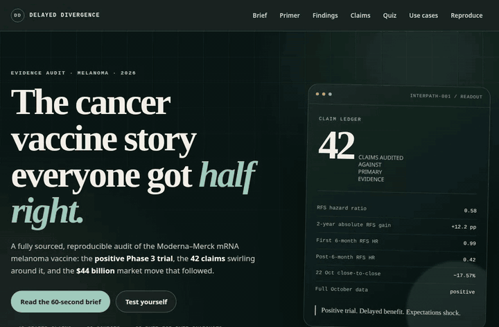
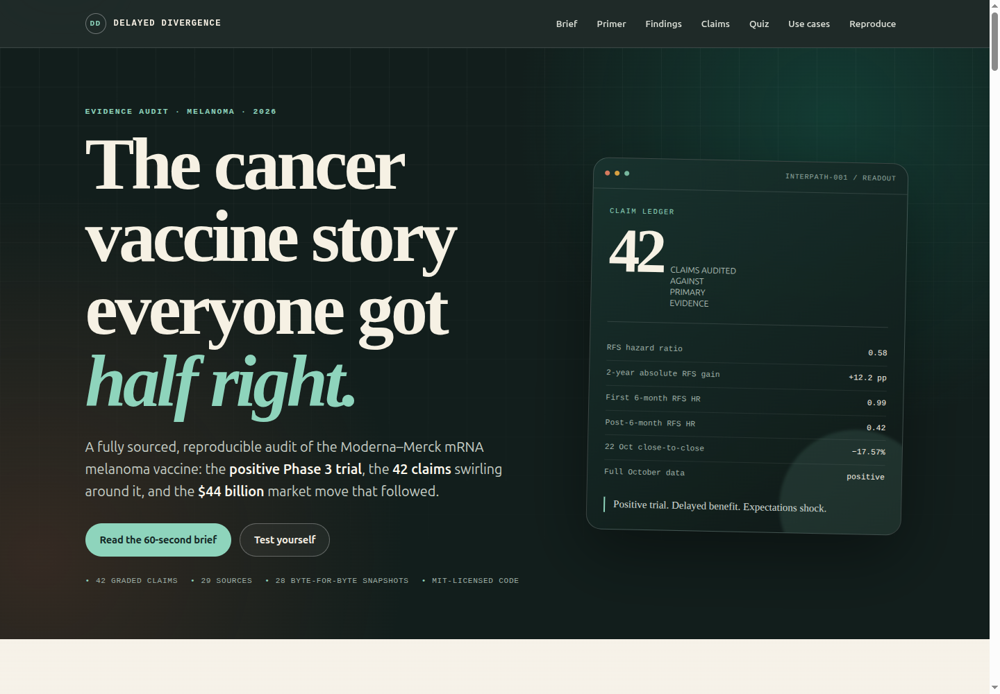
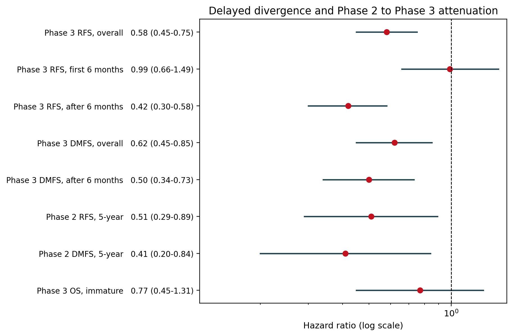
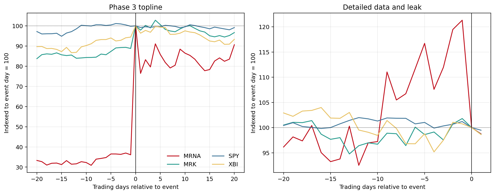
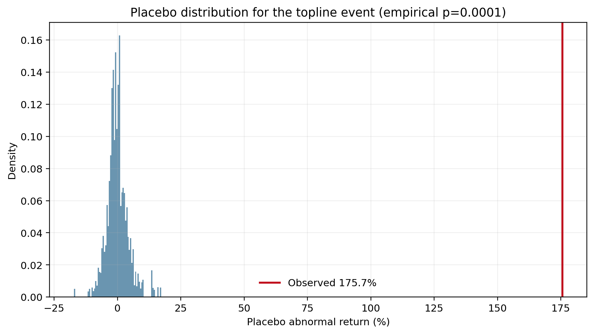
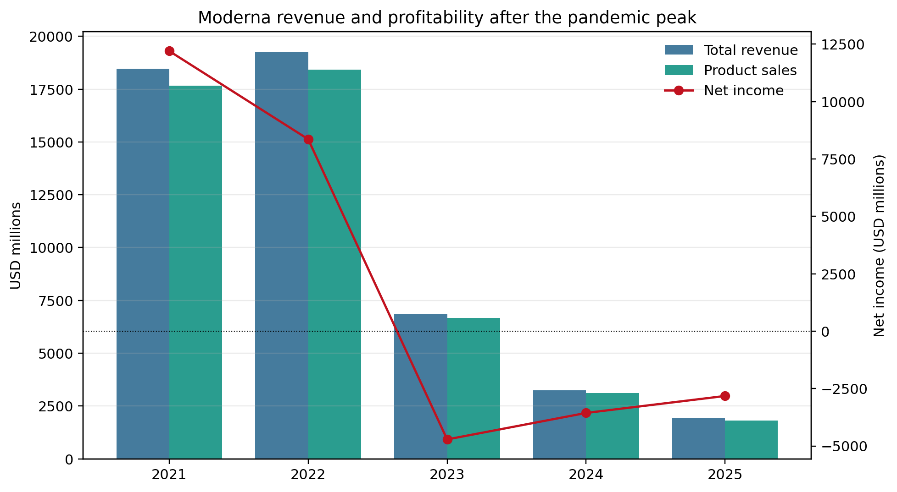
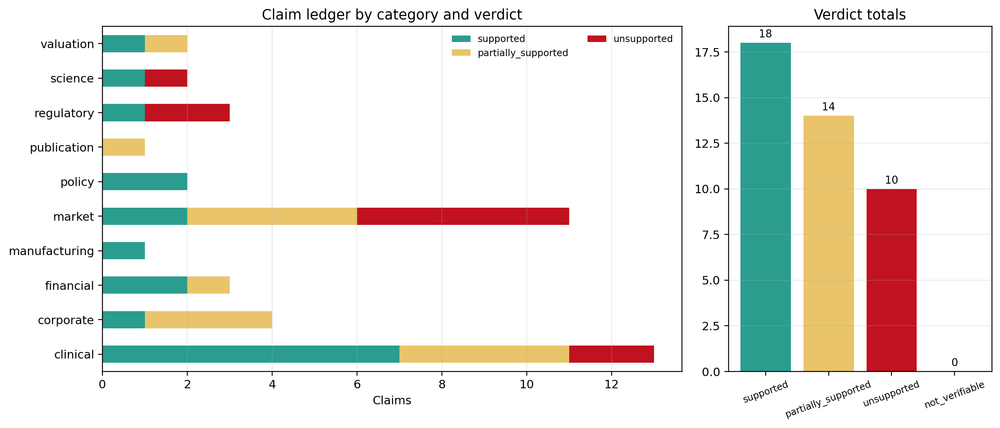

# Delayed Divergence

### A reproducible evidence audit of the Moderna–Merck mRNA melanoma vaccine — and the market reaction that followed

[](results/tables/claims.csv)
[](config/sources.yaml)
[](tests)
[](LICENSE)
[](https://m0-ar.github.io/mrna-oncology-evidence-lab/)

**One positive Phase 3 trial. Forty-two claims. A $44 billion rally. A 17.6% reversal. A story almost everyone got partly right.**

This repository turns a viral narrative about Moderna, Merck, and the individualized mRNA cancer vaccine **intismeran autogene** (V940/mRNA-4157) into an auditable evidence product. It grades 42 factual claims against 29 source records, reconstructs the clinical result and the market reaction, and packages the whole thing as a readable site, a data pack, and a reproducible Python project.

It is built for people who need to know **what is supported, what is only partly supported, and what is simply wrong** — without reading a 400-page document or trusting a screenshot.



**Live:** [home](https://m0-ar.github.io/mrna-oncology-evidence-lab/) · [preview.html](https://m0-ar.github.io/mrna-oncology-evidence-lab/preview.html) · [docs/preview.html](https://m0-ar.github.io/mrna-oncology-evidence-lab/docs/preview.html)

**Start here:** **[60-second brief](#the-60-second-brief)** · **[Beginner guide + quiz](#-beginner-guide--read-this-and-you-are-a-professional)** · **[Rebuild every number](#reproducibility)**

---

## Executive summary

**The trial worked. The benefit was delayed. The market reacted to expectations, not just efficacy.**

- **Clinical:** INTerpath-001 met its primary endpoints. Recurrence-free survival hazard ratio **0.58** (95% CI 0.45–0.75; p<0.001), a **42% relative reduction**. Distant-metastasis-free survival hazard ratio **0.62** (0.45–0.85; p=0.002), a **38% reduction**. At two years, RFS was **82.2% vs 70.0%** and DMFS **88.5% vs 80.2%**. Overall survival remains immature: HR **0.77** (0.45–1.31; p=.33).
- **The twist:** the average effect hides time dependence. The first six months look flat (RFS HR **0.99**; DMFS HR **1.01**). After month six, the piecewise RFS hazard ratio is **0.42** and DMFS is **0.50**. The observed post-six-month hazard is **57.6% lower** than the first-six-month hazard (ratio 0.424).
- **The market:** on 19 August 2026, MRNA rose **176.97%** close-to-close and added about **$44.48B** in market value. On 22 October 2026, it fell **17.57%** close-to-close and **25.06%** intraday high-to-low — while the full data were positive. That was a disclosure and expectations shock, not negative efficacy.
- **The ledger:** **42 claims** — **18 supported**, **14 partially supported**, **10 unsupported**, **0 not verifiable**. Evidence for **28 of 29 sources** is committed byte-for-byte with SHA-256 manifests; the one paywalled Bloomberg source is flagged.
- **The point:** a price move is not an endpoint, a press release is not independent proof, and “supported” is not the same as “true.”

### At a glance

| Question | Short answer |
|---|---|
| Did the trial meet its primary endpoints? | **Yes.** RFS and DMFS both met. |
| Did it prove an overall-survival benefit? | **No.** OS is immature and not statistically significant. |
| Is the vaccine approved for melanoma? | **No.** No melanoma approval was found. |
| Why did the stock fall in October? | **Expectations and disclosure**, not negative full data. |
| Was the viral story entirely false? | **No.** It was directionally right and wrong on vivid details. |
| How much evidence is behind the answer? | **42 graded claims, 29 sources, 28 committed snapshots.** |
| Can I rebuild the tables and figures? | **Yes.** Offline pipeline, tests, manifests, Docker. |
| Is this medical or investment advice? | **No.** Research and education only. |

---

## Why this matters

A single number can move billions of dollars. A single misread hazard ratio can distort a board decision, a news segment, a diligence memo, or an investment thesis.

Most narratives fail in one of four ways:

1. **The number is right, but the interpretation is wrong.** A 42% relative reduction is not a 42% absolute benefit.
2. **The result is right, but the timing is missing.** An average hazard ratio can hide a flat early period and a strong late period.
3. **The price move is real, but the cause is assumed.** A stock can fall on good data when expectations were higher.
4. **The source exists, but it does not support the claim.** A press release proves what a company said, not that the claim is clinically true.

This repository is a worked example of fixing all four. It is also a reusable pattern for any company, sector, or public narrative that mixes clinical evidence, financial claims, and market psychology.

### What a buyer or stakeholder can see in five minutes

- **The signal:** what the trial actually showed, in one table.
- **The catch:** why the average hides a six-month divergence.
- **The market:** why the October selloff was not a verdict on the data.
- **The receipts:** which claims survive, which are overstated, and which fail.
- **The machinery:** how to reproduce every number from committed source snapshots.

---

## 🌱 Beginner guide — read this and you are a professional

**[🌱 Beginner guide](#-beginner-guide--read-this-and-you-are-a-professional)** · You do not need a biology degree, a finance degree, or a statistics package. Start here.

You will know more than most interview candidates.

Let's work this out in a step-by-step way to be sure we have the right answer.

### Step 1 — Learn four ideas

| Idea | Plain-English meaning | Why it matters here |
|---|---|---|
| **Hazard ratio (HR)** | How quickly an event happens in one group compared with another over time. HR 0.58 means the treated group had 42% lower hazard, not 42% fewer events forever. | It is the trial’s headline number. It is relative and time-dependent. |
| **Absolute benefit** | The actual percentage-point gap between groups. 82.2% vs 70.0% is 12.2 points. | It tells you how many patients benefit, not just the relative reduction. |
| **Event study** | Compare a stock’s actual return with the return the market model predicts. The difference is the abnormal return. | It separates a company-specific shock from a market-wide move. |
| **Claim ledger** | A row-by-row grade of what a narrative says against what the evidence says. | It turns “I think that’s wrong” into a defensible, sourced verdict. |

### Step 2 — Read the one-paragraph version

The Phase 3 trial met its recurrence and distant-metastasis endpoints. The average effect is positive, but the benefit is concentrated after the first six months. The stock soared on the topline, then fell when detailed data arrived because expectations had run ahead of the result. Several viral details — approval, overall survival, the 2023 stock collapse, the timing of the sales decline — are wrong or overstated. The claim ledger records exactly which.

### Step 3 — Open the claim explorer

Open the [live preview](https://m0-ar.github.io/mrna-oncology-evidence-lab/preview.html), scroll to **“42 claims. Four verdicts.”**, and filter by **Clinical**, **Market**, **Regulatory**, or **Financial**. Search for any phrase. Every card shows the claim, the verdict, the evidence, the confidence, and the number of sources.

### Step 4 — Take the eight-question quiz

The interactive quiz goes from **Foundation** to **Analyst** to **Professional**. It does not ask you to memorize numbers. It asks you to interpret them. If you can explain why a stock can fall on good data, you have understood the central lesson.

### Step 5 — Verify one claim yourself

1. Pick a row in [`results/tables/claims.csv`](results/tables/claims.csv).
2. Find the source ID in [`results/tables/sources.csv`](results/tables/sources.csv).
3. Open the committed snapshot under [`evidence/snapshots/`](evidence/snapshots/).
4. Compare the exact wording, date, and number.
5. Run `python scripts/verify.py` to check the manifests and invariants.

That is the whole method: **claim → source → snapshot → hash → verdict.**

---

## Product tour

This is not only a paper. It is a small evidence product with five layers.

### 1. The interactive site

A single-page, dependency-free static site with:

- a dark editorial hero and a 60-second brief;
- a 90-second primer for non-specialists;
- clinical findings with the forest plot;
- market findings with event windows and placebo inference;
- a searchable, filterable **42-claim explorer**;
- an eight-question **beginner-to-professional quiz** with feedback and scoring;
- business use cases and a reproduction guide;
- accessible semantic structure, keyboard focus states, reduced-motion support, and print styles.

No external fonts, scripts, or CSS frameworks. The page works from a local file server or GitHub Pages.



### 2. The claim ledger

A 42-row, machine-readable table with claim ID, category, transcript wording, verdict, confidence, source IDs, evidence, notes, and joined source list. The ledger is the authoritative record; the README is the reader’s guide.

### 3. The data pack

Committed snapshots, SHA-256 manifests, processed prices, event-study windows, clinical endpoints, safety data, financial tables, and six figures. The committed data are enough to rebuild the analysis offline.

### 4. The reproducible pipeline

Python modules for ingestion, event study, clinical derivations, financial reconstruction, claim auditing, figure generation, and verification. Twenty-six tests. A deterministic `make all`. A Docker path for a clean environment.

### 5. The learning layer

The primer, claim explorer, quiz, selected corrections, and FAQ are designed to teach evidence literacy. A reader can start at zero and finish able to explain the difference between a hazard ratio, an absolute benefit, an abnormal return, and a supported claim.

---

## Who this is for

| Audience | What they get |
|---|---|
| **Executives and boards** | A one-page separation of clinical result, market narrative, and evidentiary confidence. |
| **Investors and analysts** | Raw returns, market-model CARs, placebo inference, abnormal volume, valuation reconstruction, and an explicit “price is not an endpoint” lesson. |
| **Journalists and fact-checkers** | A claim-by-claim ledger with source IDs and byte-for-byte snapshots, so a quote can be checked in minutes. |
| **Medical and science communicators** | A clear explanation of relative vs absolute benefit, surrogate endpoints, immature OS, and Phase 2-to-Phase 3 attenuation. |
| **Educators and students** | A teachable case spanning clinical statistics, event studies, source criticism, and reproducible research. |
| **Diligence and strategy teams** | A reusable template: source registry → claim ledger → event study → financial reconstruction → tests. |
| **Builders and data teams** | A working example of deterministic analysis, manifest verification, static-site generation, and Docker reproduction. |

### User stories

- **As an investor,** I can see whether a large stock move was company-specific or market-wide, and whether the move is consistent with the clinical news.
- **As a board member,** I can ask “what exactly is supported?” and get a claim-level answer rather than a narrative.
- **As a journalist,** I can open the snapshot behind a quote and check the wording and date myself.
- **As a teacher,** I can use the quiz and claim explorer to show why “supported” is not “true.”
- **As a diligence lead,** I can copy the structure for another company without rebuilding the evidence discipline from scratch.

---

## The 60-second brief

### 1. The trial was positive

INTerpath-001 randomized **1,137** patients with completely resected stage IIB–IV melanoma 2:1 to intismeran plus pembrolizumab or placebo plus pembrolizumab. At a median follow-up of **24.6 months**, both primary endpoints were met.

| Endpoint | Combination | Control | Effect |
|---|---:|---:|---|
| 2-year RFS | **82.2%** | **70.0%** | HR **0.58** (0.45–0.75), p<0.001 |
| 2-year DMFS | **88.5%** | **80.2%** | HR **0.62** (0.45–0.85), p=0.002 |
| Overall survival | immature | immature | HR **0.77** (0.45–1.31), p=.33 |

The absolute 2-year RFS gain is **12.2 percentage points**, or roughly **one additional recurrence-free patient for every 8.2 treated**. The absolute DMFS gain is **8.3 points**, or **one additional distant-metastasis-free patient for every 12.0 treated**.

### 2. The benefit arrived late

The average is true and incomplete. The first six months show essentially no separation:

- first-six-month RFS HR **0.99** (0.66–1.49);
- first-six-month DMFS HR **1.01** (0.58–1.79);
- post-six-month piecewise RFS HR **0.42** (0.30–0.58);
- post-six-month piecewise DMFS HR **0.50** (0.34–0.73).

The post-six-month hazard is **57.6% lower** than the first-six-month hazard (0.42 / 0.99 = 0.424). That is a description of the observed data, not proof of a six-month biological switch. The pattern is consistent with an adaptive immune response that takes time to mature; the trial was not designed to prove that mechanism.

### 3. The market reacted twice

| Event | Date | Close-to-close | Intraday high-to-low | Market value | Volume |
|---|---|---:|---:|---:|---:|
| Positive topline | 2026-08-19 | **+176.97%** | — | **+$44.48B** | **199.25M**, 33.5× |
| Detailed data + leak | 2026-10-22 | **−17.57%** | **−25.06%** | **−$17.24B** | **49.95M**, 3.29× |

The August move was a massive positive repricing. The October move was a negative repricing **despite positive full data**. CNBC reported the stock fell “even though the full data, released later Thursday, appeared positive.” UBS called it “overall a strong data set” while pointing to “massive expectations.” The correct interpretation is **expectations and disclosure**, not failed efficacy.

### 4. Several vivid details fail

| Transcript claim | Verdict | Evidence |
|---|---|---|
| “Lost two-thirds in 2023” | **Unsupported** | 2023 return was **−44.63%**; 2024 was **−58.19%**. |
| “Sales fell to $3B in 2023” | **Partially supported** | 2023 revenue was **$6.848B**; 2024 was **$3.236B**. |
| “Stock fell below $10” | **Unsupported** | Post-peak closing trough was **$22.36** on 2025-11-20. |
| “One-day 25% collapse” | **Partially supported** | Intraday high-to-low **−25.06%**; close-to-close **−17.57%**. |
| “Market cap above $200B” | **Partially supported** | Peak close implies about **$195.6B**; intraday peak about **$200.8B**. |
| “About 4,500 employees” | **Partially supported** | 2025 10-K reports about **4,700**. |
| “$500M canceled” | **Supported with nuance** | HHS says **nearly $500M** across 22 projects. |
| “Keytruda patent expires in 2028” | **Partially supported** | Core compound patent Dec 2028; two additional patents run into 2029. |
| “Vaccine is approved” | **Unsupported** | No melanoma approval found; the FDA approved MFLUSIVA for influenza, a different product. |
| “Trial proved survival benefit” | **Unsupported** | OS HR 0.77 (0.45–1.31), p=.33; immature. |

The full 42-row ledger is the authoritative list. The table above is only a reader’s guide.

---

## The 6-minute briefing

### Clinical: the average hides the timing



The forest plot makes the central pattern visible: the overall RFS and DMFS effects are significant, but the first-six-month confidence interval crosses 1, while the post-six-month interval is far below 1. The Phase 2 estimates are more extreme than the Phase 3 estimates, especially for DMFS.

The 5-year KEYNOTE-942 update reported a **49% RFS reduction** (HR 0.51) and a **59% DMFS reduction** (HR 0.41). Phase 3 attenuated both:

| Comparison | Phase 2 | Phase 3 | Attenuation |
|---|---:|---:|---:|
| RFS reduction | 49% | 42% | **7 percentage points** (14.3% relative) |
| DMFS reduction | 59% | 38% | **21 percentage points** (35.6% relative) |
| RFS HR | 0.51 | 0.58 | ratio 1.14 |
| DMFS HR | 0.41 | 0.62 | ratio 1.51 |

This is the pattern expected from winner’s curse and effect-size shrinkage when a promising Phase 2 moves to a larger, more definitive trial. It does not make the Phase 3 result negative. It does mean that quoting the Phase 2 number as if it were the confirmed effect is misleading.

**Safety context:** any treatment-related adverse event was **95.8% vs 90.0%**; Grade 3–5 TRAEs were **14.2% vs 13.4%**. Pyrexia (**52.2%**), injection-site pain (**51.0%**), and fatigue (**38.5%**) were the most common events in the combination arm. The absolute excess in any TRAE is 5.8 points (NNH 17.24); the Grade 3–5 excess is 0.8 points (NNH 125). These are arithmetic translations, not causal claims.

### Market: a price move is not an endpoint



| Event | Window | Raw return | Market-model CAR | Placebo p |
|---|---|---:|---:|---:|
| 2026-08-19 topline | [0,0] | +176.97% | **+175.66%** | 0.0001 |
| 2026-08-19 topline | [−1,1] | +106.83% | **+110.31%** | 0.0001 |
| 2026-08-19 topline | [0,1] | +111.75% | **+113.31%** | 0.0001 |
| 2026-08-19 topline | [0,5] | — | **+136.39%** | 0.0001 |
| 2026-08-19 topline | [0,20] | — | **+146.27%** | 0.0001 |
| 2026-10-22 detailed data | [0,0] | −17.57% | **−16.11%** | 0.0026 |
| 2026-10-22 detailed data | [−1,1] | −17.34% | **−16.12%** | 0.021398 |
| 2026-10-22 detailed data | [0,1] | −18.60% | **−16.58%** | 0.011899 |
| 2026-10-22 detailed data | [0,5] | — | not estimable | — |
| 2026-10-22 detailed data | [0,20] | — | not estimable | — |

The October [0,5] and [0,20] windows are not estimable because the price data end on 2026-10-23. The p-values come from 10,000 placebo draws; 0.0001 is the reporting floor, not a continuous exact value.

**Robustness:** against XBI, the August event-day CAR is **+155.29%**; the October event-day CAR is **−16.62%** (p=0.0001) and the [−1,1] CAR is **−14.23%** (p=0.026097). The SPY market-model beta is **1.5934** (R²=0.0920); the XBI beta is **1.434** (R²=0.3221). The low SPY R² is a reminder that most of a single stock’s daily variance is idiosyncratic.



The topline move is far outside the placebo distribution. The October move is smaller but still unusual. Neither fact tells us whether the underlying data were good or bad; they tell us the information was material and the market was surprised.

### Valuation and long-run performance

| Date | Close | Market cap* | Change |
|---|---:|---:|---:|
| 2026-08-18 | $62.96 | $25.14B | — |
| 2026-08-19 | $174.38 | $69.62B | **+$44.48B** |
| 2026-10-21 | $245.81 | $98.14B | — |
| 2026-10-22 | $202.63 | $80.90B | **−$17.24B** |

\*Using 399,235,889 shares outstanding as of 2026-07-24. Market cap is a mechanical close × shares calculation, not a fully diluted enterprise value.

The long-run stock history also corrects the transcript’s impressionistic collapse narrative:

- peak close **$484.47** on 2021-08-09;
- post-peak closing trough **$22.36** on 2025-11-20;
- maximum close-to-close drawdown **−95.38%**;
- annual returns: 2023 **−44.63%**, 2024 **−58.19%**, 2025 **−29.08%**;
- 2026 YTD through 2026-10-22: **+587.1%**.

### Financial reconstruction



| Year | Revenue | Product sales | Net income | R&D |
|---|---:|---:|---:|---:|
| 2021 | $18.471B | $17.675B | $12.202B | $1.991B |
| 2022 | $19.263B | $18.435B | $8.362B | $3.295B |
| 2023 | $6.848B | $6.671B | −$4.714B | $4.845B |
| 2024 | $3.236B | $3.109B | −$3.561B | $4.543B |
| 2025 | $1.944B | $1.818B | −$2.822B | $3.132B |

The pandemic-era totals were enormous: 2021 plus 2022 revenue was **$37.734B**, and product sales were **$36.110B**. The post-pandemic decline was also enormous, but it was **multi-year**. The $3B-scale revenue year was 2024, not 2023. Q2 2026 revenue was **$145M** with a **$782M** net loss and **$1.97** EPS loss.

---

## Claim ledger

The ledger separates four verdicts:

- **supported** — the proposition is directly supported by a primary or high-quality secondary source;
- **partially supported** — the direction is right but a number, timing, scope, or causal claim is wrong;
- **unsupported** — the available evidence contradicts the proposition, or the proposition asserts something for which no adequate evidence exists;
- **not verifiable** — the proposition cannot be tested with available public evidence.

Two grading rules matter:

1. **Supported is not the same as true.** A claim that “HHS said X” can be supported even if X is scientifically contested. The ledger grades the transcript’s fidelity to evidence, not the underlying truth of every official statement.
2. **A source existing is not the same as a source supporting the claim.** Press releases are primary evidence for what a company said, not independent proof that the claim is clinically correct.

**Current totals: 42 claims; 18 supported, 14 partially supported, 10 unsupported, 0 not verifiable.**

| Category | Claims |
|---|---:|
| Clinical | 13 |
| Market | 11 |
| Corporate | 4 |
| Regulatory | 3 |
| Financial | 3 |
| Valuation | 2 |
| Science | 2 |
| Policy | 2 |
| Manufacturing | 1 |
| Publication | 1 |



### How to read a claim row

```text
id | category | transcript_claim | verdict | confidence | sources | evidence | notes | sources_joined
```

Example:

```text
C02 | clinical | The vaccine reduced recurrence or death by 42%. | supported | high |
merck_phase3_details | HR 0.58 corresponds to a 42% relative reduction in the
hazard of recurrence or death. | Relative, not absolute, risk reduction. |
merck_phase3_details
```

Open [`results/tables/claims.csv`](results/tables/claims.csv) for all 42 rows, or use the searchable explorer in the preview.

---

## Data and provenance

Evidence for **28 of the 29 sources** is committed under [`evidence/snapshots/`](evidence/snapshots/); the one paywalled Bloomberg source is retained as a flagged secondary record. The manifest [`evidence/manifests/snapshots.json`](evidence/manifests/snapshots.json) records SHA-256 hashes, byte sizes, source IDs, publishers, and URLs. Price files are separately hashed in [`evidence/manifests/prices.json`](evidence/manifests/prices.json).

Primary sources include:

- Merck/Moderna topline release, 2026-08-19;
- Merck/Moderna detailed Phase 3 release, 2026-10-22;
- Moderna topline mirror, 2026-08-19;
- ClinicalTrials.gov NCT05933577;
- ASCO 2026 KEYNOTE-942 5-year abstract (DOI 10.1200/JCO.2026.44.16_suppl.9500);
- FDA MFLUSIVA product page and clinical review;
- HHS BARDA wind-down release, 2025-08-05;
- Moderna 2025 Form 10-K, 2022 Form 10-K product-sales table, and Q2 2026 release;
- Merck 2025 Form 10-K, 2022 Q4 release, 2016 collaboration release, and 2022 option-exercise release;
- NIH IRP account of the COVID-19 vaccine timeline and Moderna’s 2020 SEC exhibit;
- CNBC, Science Media Centre, and OncLive reporting;
- Federal Reserve placebo-event-study paper;
- Yahoo Finance and Nasdaq daily price/volume data.

The FDA clinical review was retrieved through the Internet Archive because the live PDF endpoint returned HTTP 401 during retrieval. The archived PDF is committed, and the relevant text is also committed as extracted text. This is a provenance limitation, not a hidden adjustment.

### Trust, but verify

Every claim is designed to be checked without trusting the author:

1. Open the claim row in [`results/tables/claims.csv`](results/tables/claims.csv).
2. Follow the source ID to [`results/tables/sources.csv`](results/tables/sources.csv).
3. Open the committed snapshot and compare the exact wording.
4. Check the file against [`evidence/manifests/snapshots.json`](evidence/manifests/snapshots.json).
5. Run `python scripts/verify.py` to confirm manifest integrity and numerical invariants.

That is the product: **not a conclusion you have to believe, but a trail you can audit.**

---

## Data dictionary

| Path | What it contains | Grain |
|---|---|---|
| [`config/sources.yaml`](config/sources.yaml) | Source registry: title, publisher, date, type, tier, URL, snapshot path | One row per source |
| [`config/claims.yaml`](config/claims.yaml) | 42 transcript claims with verdict, confidence, evidence, notes | One row per claim |
| [`config/events.yaml`](config/events.yaml) | Event dates, windows, estimation window, placebo settings | One row per event |
| [`config/clinical_endpoints.yaml`](config/clinical_endpoints.yaml) | Phase 2/3 endpoints, safety, enrollment, derived inputs | Structured key-value |
| [`config/financials.yaml`](config/financials.yaml) | Annual and quarterly financials, shares, Keytruda context | Structured key-value |
| [`results/tables/claims.csv`](results/tables/claims.csv) | Graded claim ledger with source IDs and evidence notes | One row per claim |
| [`results/tables/event_study.csv`](results/tables/event_study.csv) | Event/model/window CARs, beta, R², placebo p-values | One row per event × model × window |
| [`results/tables/clinical_endpoints.csv`](results/tables/clinical_endpoints.csv) | RFS, DMFS, OS, and subgroup estimates | One row per endpoint/arm |
| [`results/tables/clinical_safety.csv`](results/tables/clinical_safety.csv) | Adverse-event rates by arm | One row per event/arm |
| [`results/tables/financial_annual.csv`](results/tables/financial_annual.csv) | Revenue, product sales, net income, R&D | One row per year |
| [`results/tables/sources.csv`](results/tables/sources.csv) | Source registry with snapshot existence and URLs | One row per source |
| [`evidence/manifests/snapshots.json`](evidence/manifests/snapshots.json) | SHA-256, byte size, source ID, path | One row per snapshot |
| [`evidence/manifests/prices.json`](evidence/manifests/prices.json) | SHA-256 and metadata for price files | One row per price file |
| [`paper/results_summary.json`](paper/results_summary.json) | Machine-readable headline, derived, event, financial, and claim summary | One JSON object |

### Key definitions

| Term | Definition |
|---|---|
| **RFS** | Recurrence-free survival: time without cancer recurrence or death. |
| **DMFS** | Distant-metastasis-free survival: time without distant metastasis or death. |
| **OS** | Overall survival: time until death from any cause. |
| **HR** | Hazard ratio. HR < 1 favors the combination. |
| **CI** | Confidence interval. A 95% CI is a range of plausible values under the model. |
| **CAR** | Cumulative abnormal return: the sum of daily returns not explained by the market model. |
| **Placebo p-value** | Empirical two-sided p-value from pseudo-event draws. |
| **NNT** | Number needed to treat for one additional favorable outcome. |
| **Supported** | The claim faithfully matches the cited evidence. It is not a claim of universal truth. |
| **Partially supported** | Directionally right, but a number, timing, scope, or causal detail is wrong. |
| **Unsupported** | The evidence contradicts the claim, or there is no adequate evidence for it. |
| **Not verifiable** | The claim cannot be tested with available public evidence. |

---

## Reproducibility

Requirements: Python 3.11+ with NumPy, pandas, matplotlib, and PyYAML. The committed data make the pipeline offline-capable.

```bash
python -m venv .venv
source .venv/bin/activate
pip install -e .
make all
```

`make all` runs the pipeline, regenerates the site data bundle, runs the **26-test** suite, and verifies the manifest/result invariants.

To rebuild only the analysis:

```bash
PYTHONPATH=src python -m mrna_evidence.pipeline
```

To rebuild only the interactive data bundle:

```bash
make site
```

To run the containerized reproduction:

```bash
docker compose build
docker compose run --rm lab make all
```

To preview the static site locally:

```bash
python -m http.server 8000
# open http://localhost:8000/preview.html
```

The pipeline writes:

- `data/processed/prices.csv`, `returns.csv`, `event_study.csv`;
- `results/tables/*.csv`;
- `results/figures/*.png` and `paper/figures/*.png`;
- `paper/results_summary.json`;
- `assets/site-data.js`;
- updated SHA-256 manifests.

`python scripts/verify.py` checks manifest integrity and key numerical invariants. A non-zero exit means the artifact is not reproducible.

### Repository layout

```text
assets/                  site CSS, JS, generated claim data, screenshots, GIF, video
config/                  sources, claims, events, clinical and financial inputs
data/raw/prices/         committed Yahoo/Nasdaq price snapshots
data/processed/          generated price and return panels
evidence/snapshots/      committed primary-source snapshots
evidence/manifests/      SHA-256 manifests and run summary
src/mrna_evidence/       ingestion, event study, clinical, financial, claim audit
scripts/                 site-data/mirror builders and verifier
tests/                   unit, integration, and site checks
results/tables/          generated tables
results/figures/         generated figures
paper/                   manuscript, figures, and machine-readable summary
preview.html             interactive static site
index.html               redirect to preview.html
docs/                    /docs/preview.html mirror
.nojekyll                GitHub Pages bypass file
```

---

## Interactive preview and GitHub Pages

The preview is a fully static page. It needs no build step at runtime:

- `preview.html` — the interactive site;
- `assets/site.css` — the editorial styling;
- `assets/site.js` — claim explorer and quiz;
- `assets/site-data.js` — generated from `results/tables/claims.csv`;
- `assets/preview-hero.png` — README/hero screenshot;
- `assets/social-preview.png` — social sharing image;
- `assets/demo.gif` — animated tour;
- `index.html` — redirect to `preview.html`;
- `docs/preview.html` — mirror served at `/docs/preview.html`;
- `docs/index.html` — redirect for the `/docs/` path;
- `docs/.nojekyll` — keeps the mirror static;
- `.nojekyll` — tells GitHub Pages not to run Jekyll.

### Live site

The site is live at **https://m0-ar.github.io/mrna-oncology-evidence-lab/** and deploys from **`main` / `(root)`**.

| URL | What it serves |
|---|---|
| `/` | redirects to the interactive preview |
| `/preview.html` | primary interactive preview |
| `/docs/preview.html` | mirror for the `docs/` path |

`make site` regenerates `assets/site-data.js` and the `docs/` mirror from the canonical `preview.html`.

To recreate the same setup on a fork:

1. Push the repository to GitHub.
2. Open **Settings → Pages**.
3. Under **Build and deployment**, choose **Deploy from a branch**.
4. Select **main** and **/ (root)**.
5. Save. The site will be served at `https://<owner>.github.io/<repo>/`.
6. `index.html` redirects to `preview.html`; `docs/preview.html` remains available as a mirror.

GitHub Pages sites are public even when the repository is private. The page has no external JS, CSS, or font dependencies, so it works from the repository root without a build pipeline.

---

## Methods

### Event study

We compute daily log returns for MRNA, SPY, XBI, and IBB. The primary model is a one-factor market model estimated by OLS over **2025-08-01 to 2026-07-31**:

\[
R_{i,t} = \alpha_i + \beta_i R_{m,t} + \varepsilon_{i,t}
\]

Abnormal returns are \(\widehat{AR}_{i,t} = R_{i,t} - (\hat\alpha_i + \hat\beta_i R_{m,t})\). Cumulative abnormal returns sum AR over the event window. We report raw returns, market-model CARs, simple market-adjusted returns, and XBI-adjusted returns. The same estimation window is used for both events to avoid contaminating the model with the first shock.

### Placebo inference

For each event/model/window, we draw 10,000 pseudo-event dates from trading days outside a ±10-day guard band around the two real events. The empirical two-sided p-value is:

\[
p = \frac{1 + \#\{|CAR_{placebo}| \ge |CAR_{event}|\}}{1 + N}
\]

With 10,000 draws, the smallest reportable p-value is 0.0001. A p-value at that floor means “no placebo draw was as extreme,” not “p is exactly 0.0001 in a continuous sense.”

### Volume

Abnormal volume is the event-day volume divided by the median volume over the prior 60 trading days. We also report the log deviation and the prior percentile. This is descriptive; it is not a structural model of informed trading.

### Clinical derivations

- Absolute RFS gain = 82.2 − 70.0 = **12.2 percentage points**.
- NNT = 100/12.2 = **8.20**.
- Absolute DMFS gain = 88.5 − 80.2 = **8.3 points**; NNT = **12.05**.
- Delayed-effect ratio = 0.42/0.99 = **0.424**.
- Phase 2-to-Phase 3 attenuation = 49−42 = **7 pp** for RFS; 59−38 = **21 pp** for DMFS.
- Any-TRAE excess = 95.8−90.0 = **5.8 pp**; NNH = **17.24**.
- Grade 3–5 TRAE excess = 14.2−13.4 = **0.8 pp**; NNH = **125**.

These are arithmetic translations of reported proportions. They are not substitute estimates of causal effect.

### Financial reconstruction

Revenue, product sales, net income, and R&D are taken from SEC filings. Market capitalization uses **399,235,889 shares** outstanding as of 2026-07-24. The peak-valuation calculation uses **403.6M shares** contemporaneous with the 2021 peak, because using today’s share count would understate the 2021 market cap.

---

## Limitations

1. **Single-firm event study.** MRNA is volatile and idiosyncratic. The market model explains only about 9% of daily variance versus SPY and 32% versus XBI. Placebo inference is robust to non-normality but cannot rule out all omitted news.
2. **Event-date ambiguity.** The October event involved a leak and a later full release. Intraday timing, headline sequencing, and analyst revisions are not fully observable in daily data.
3. **Surrogate endpoints.** RFS and DMFS are not overall survival. The OS confidence interval is wide and compatible with substantial benefit or no benefit.
4. **Publication status.** The Phase 3 results were presented at ESMO 2026 as LBA1 and accepted by NEJM, but no DOI or published version was available as of 2026-10-24. This repository does not call them peer-reviewed published.
5. **Registry lag.** ClinicalTrials.gov still listed an estimated enrollment of 1,089 while the companies reported 1,137 randomized. The registry record is useful for design and dates, not for final enrollment.
6. **Safety denominators.** Safety analyses used 755 + 380 = 1,135 patients, not the 1,137 randomized. The two-patient difference is small but should not be hidden.
7. **Proprietary short-interest data.** The widely reported $5.5B short-seller loss is a Bloomberg/S3 estimate, not independently reproducible from public data.
8. **Official statements are not truth.** HHS’s assertion that mRNA vaccines “fail to protect effectively” is recorded as an official claim, not endorsed as a scientific conclusion. The clinical evidence is contested and product-specific.
9. **Market-cap precision.** Close × current shares is not enterprise value. The “$200B” claim is reproducible only on an intraday peak with contemporaneous shares, and even then only barely.
10. **No causal claim about the vaccine’s mechanism.** The delayed hazard pattern is an observed statistical pattern. The repository does not prove that the six-month immunization schedule causes the delay.

---

## What the evidence supports, and what it does not

### Supported

- The Phase 3 trial met RFS and DMFS endpoints.
- The relative RFS reduction was 42%; the 2-year absolute RFS gain was 12.2 points.
- The benefit is concentrated after six months.
- Overall survival is immature and not statistically significant.
- Phase 2 effects attenuated in Phase 3.
- The August topline produced an extraordinary positive market reaction.
- The October drop followed a leak and a disclosure/expectations shock, not negative full data.
- Moderna’s pandemic revenue was about $37.7B across 2021–2022.
- HHS announced a wind-down of 22 mRNA projects worth nearly $500M.
- Keytruda was about 35% of Merck’s 2022 revenue.

### Not supported

- The vaccine is approved for melanoma.
- The trial proved a survival benefit.
- The vaccine prevents melanoma in healthy people.
- The October data were negative.
- Moderna lost two-thirds of its value in 2023.
- Moderna’s stock fell below $10.
- Moderna’s 2023 revenue was $3B.
- The FDA’s flu-vaccine approval proves the cancer vaccine works.
- Price reaction is evidence about efficacy.

---

## FAQ

**Did the trial succeed?**
Yes. It met its primary RFS and DMFS endpoints. That is not the same as proving a cure or an overall-survival benefit.

**Why is the benefit described as delayed?**
The first-six-month RFS hazard ratio is 0.99; the post-six-month piecewise hazard ratio is 0.42. The average effect is positive, but the benefit is concentrated later. The trial was not designed to prove the biological mechanism behind the pattern.

**Why did the stock fall on positive data?**
The October event combined a leak, a detailed-data release, and very high expectations. The full data were positive, but the market had priced a larger surprise. A price move is not an efficacy endpoint.

**Is “supported” the same as “true”?**
No. The ledger grades whether the transcript faithfully matches the cited evidence. An official statement can be supported as a statement even if the underlying science is contested. The README and site repeat this distinction because it is the most common mistake in evidence work.

**Is the vaccine approved?**
Not for melanoma. The FDA approved MFLUSIVA for influenza, a different product. The ledger marks melanoma-approval claims as unsupported.

**Why are only 28 of 29 sources snapshotted?**
One Bloomberg source is paywalled. It is retained as a flagged secondary record, not silently treated as reproducible. The rest are committed with SHA-256 manifests.

**What does “not verifiable” mean?**
A claim that cannot be tested with available public evidence. The current ledger has zero not-verifiable claims, but the category remains in the schema for future audits.

**Can I reuse the code and data?**
The code and original text are MIT-licensed. Third-party source snapshots remain subject to their publishers’ terms; see [`NOTICE`](NOTICE). Do not republish paywalled or copyrighted source material as your own.

**Is this medical or investment advice?**
No. It is a research and education artifact. It is not a substitute for medical advice, a clinical decision, a security recommendation, or independent diligence.

**How do I publish the site?**
Push the repository, open Settings → Pages, choose “Deploy from a branch,” select `main` and `/ (root)`, and save. The live site is `https://m0-ar.github.io/mrna-oncology-evidence-lab/`; `index.html` redirects to `preview.html`, and `docs/preview.html` is the mirror.

**How current is the audit?**
The Phase 3 readout is current through 2026-10-24. The repository is designed to be updated when a published version, DOI, or new survival data appear.

---

## Citation

If you use this repository in research, teaching, or diligence, cite:

```bibtex
@software{delayed_divergence_2026,
  title     = {Delayed Divergence: A Reproducible Evidence Audit of the Moderna-Merck mRNA Melanoma Vaccine and Its Market Reaction},
  author    = {{Delayed Divergence contributors}},
  year      = {2026},
  version   = {1.0.0},
  license   = {MIT},
  note      = {Clean-room reproducibility artifact; clinical readout current through 2026-10-24}
}
```

A machine-readable [`CITATION.cff`](CITATION.cff) is included.

---

## License, ethics, and third-party rights

- **Code and original text:** MIT License. See [`LICENSE`](LICENSE).
- **Third-party source snapshots:** remain subject to their publishers’ terms. See [`NOTICE`](NOTICE).
- **Human subjects:** no human-subject data were collected. All clinical information is from public trials, regulatory documents, company releases, or peer-reviewed/conference sources.
- **Scope:** research and reproducibility only. Not medical advice. Not investment advice. Not a claim that the vaccine is approved, proven to extend survival, or appropriate for any individual patient.
- **Corrections:** if a source, number, or verdict is wrong, open an issue with the claim ID and evidence. The ledger is designed to be corrected in public, with a new snapshot and a new hash.

---

## Contributing

See [`CONTRIBUTING.md`](CONTRIBUTING.md). The short version:

1. Do not hand-edit generated evidence. Change the source or config, then rebuild.
2. Every new claim needs a source ID, a snapshot, a hash, and an evidence note.
3. Preserve the four-verdict schema and the “supported ≠ true” rule.
4. Run `make all` and the site checks before opening a pull request.
5. Do not include paywalled source text, personal data, or medical advice.

---

## References

1. Merck & Co. and Moderna. “Merck and Moderna Announce Phase 3 INTerpath-001 Trial of Intismeran Autogene Plus KEYTRUDA Met Endpoints of Recurrence-Free Survival (RFS) and Distant Metastasis-Free Survival (DMFS) in Patients With Completely Resected Stage IIB-IV Melanoma.” 2026-08-19.
2. Merck & Co. and Moderna. “Merck and Moderna Will Present Results From Landmark Phase 3 INTerpath-001 Trial for Intismeran Autogene Plus KEYTRUDA (pembrolizumab) at ESMO 2026 Presidential Symposium.” 2026-10-22.
3. Moderna. “Merck and Moderna Announce Phase 3 INTerpath-001 Trial … Met Endpoints …” 2026-08-19.
4. CNBC. “Moderna shares plunge after cancer vaccine data leaks — despite positive results.” 2026-10-22.
5. Science Media Centre. “Expert reaction to abstract of Phase 3 INTerpath-001 trial results …” 2026-10-23.
6. OncLive. “Adjuvant Intismeran Autogene Plus Pembrolizumab Improves RFS and DMFS in Melanoma.” 2026-10-22.
7. ClinicalTrials.gov. NCT05933577, INTerpath-001.
8. Journal of Clinical Oncology. “Individualized neoantigen therapy intismeran autogene plus pembrolizumab in resected melanoma: 5-year update of KEYNOTE-942.” DOI 10.1200/JCO.2026.44.16_suppl.9500.
9. U.S. Food and Drug Administration. MFLUSIVA product page and clinical review, 2026.
10. U.S. Department of Health and Human Services. “HHS Winds Down mRNA Vaccine Development Under BARDA.” 2025-08-05.
11. NIH Intramural Research Program. “That Record-breaking Sprint to Create a COVID-19 Vaccine.” 2021.
12. Moderna, Inc. Form 10-K for fiscal year 2025.
13. Moderna, Inc. 2022 Form 10-K product-sales table.
14. Moderna, Inc. Second-quarter 2026 results.
15. Merck & Co. Form 10-K for fiscal year 2025.
16. Merck & Co. “Merck and Moderna Announce Strategic Collaboration on mRNA-Based Personalized Cancer Vaccines.” 2016-06-29.
17. Merck & Co. “Merck and Moderna Announce Exercise of Option for Joint Development and Commercialization.” 2022-10-12.
18. Merck & Co. Fourth-quarter and full-year 2022 results. 2023-02-02.
19. Coglianese J, Fang JA. “An Evaluation of Difference-in-Differences Methods Using Placebo Event Studies.” Finance and Economics Discussion Series 2026-045. Federal Reserve Board, 2026. DOI 10.17016/FEDS.2026.045.
20. MIRROR: Local Evidence Bundles for Reproducible Research Software Review, with a JANUS Case Study. *Journal of Open Research Software*. DOI 10.5334/jors.753.
21. Bloomberg. “Moderna’s 160% Surge Burns Shorts in Painful $5 Billion Loss.” 2026-08-19. Paywalled; not snapshotted.
22. Yahoo Finance and Nasdaq historical price/volume data, retrieved 2026-10-24.
23. Moderna, Inc. SEC exhibit on the COVID-19 vaccine timeline. 2020-03-16.

Full URLs and snapshot paths are in [`config/sources.yaml`](config/sources.yaml) and [`results/tables/sources.csv`](results/tables/sources.csv).

---

**Version 1.0.0 · Last updated 2026-10-25 · Code MIT · Research and education only**
